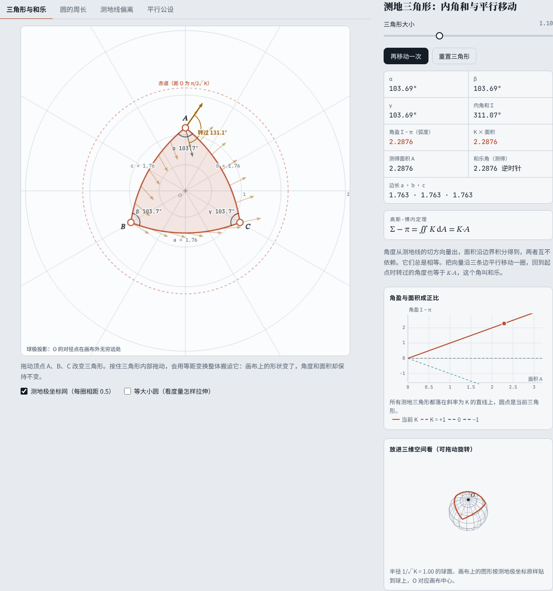
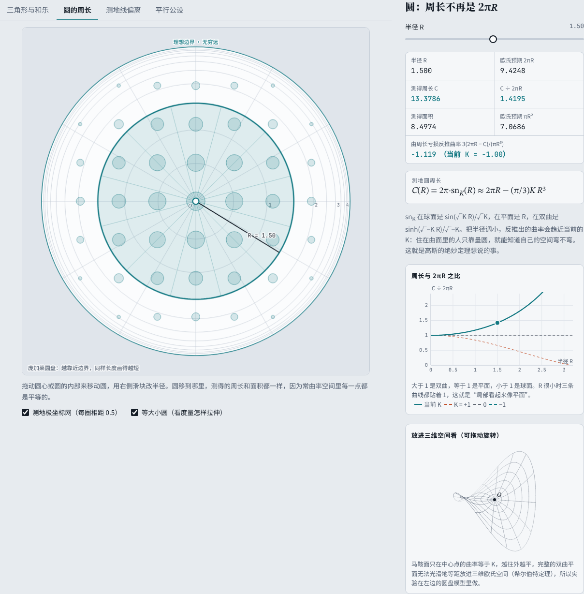
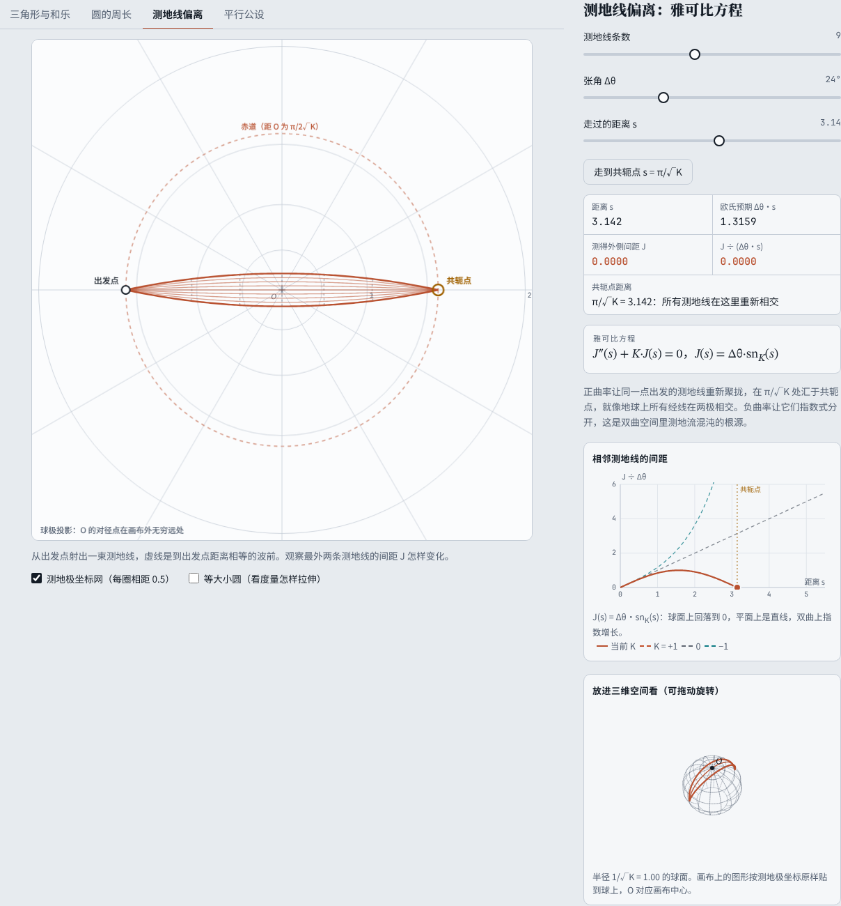
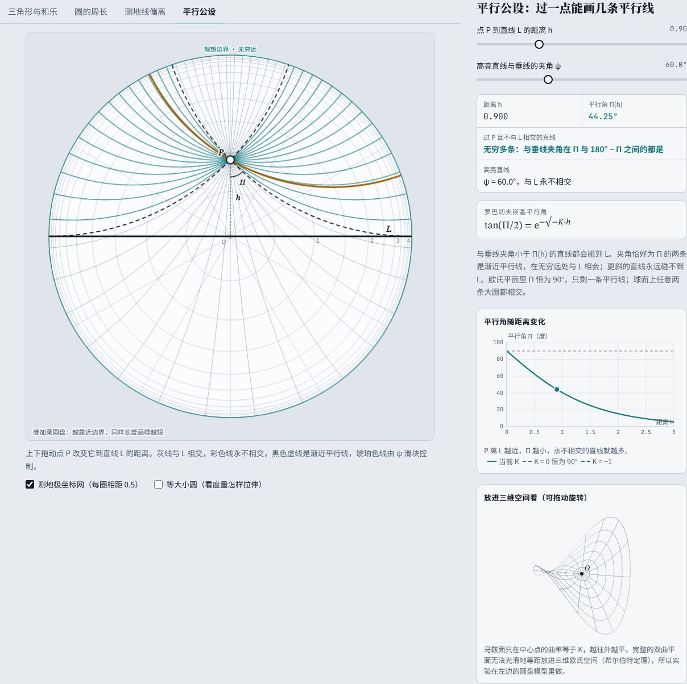
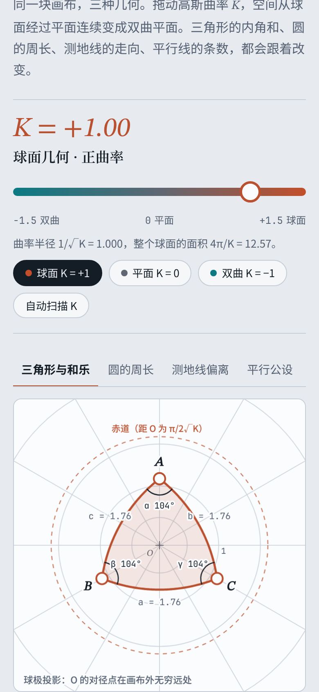

# 曲率实验室

一个可以亲手操作的黎曼几何实验台。拖动高斯曲率 K，空间从球面经过平面连续变成双曲平面；三角形内角和、圆的周长、测地线的走向、平行线的条数都会实时跟着改变，每个读数都由程序当场测量，再与理论公式对照。

**在线体验：** https://wanglu2016.github.io/qulv-shiyanshi/



| 双曲平面上的圆（打开“等大小圆”图层） | 球面上的测地线在共轭点重新相交 |
| --- | --- |
|  |  |
| **双曲平面：过直线外一点有无穷多条平行线** | **手机上的样子** |
|  |  |

## 怎么用

页面顶部是曲率滑块，范围 −1.5 到 +1.5。也可以点“球面 K = +1”“平面 K = 0”“双曲 K = −1”直接跳转，或点“自动扫描 K”让曲率来回变化。

下面有四个实验，右侧面板调参数并显示测量结果：

| 实验 | 可以做什么 | 能看到的结论 |
| --- | --- | --- |
| 三角形与和乐 | 拖动顶点；在三角形内部按住拖动会整体搬运它；点“沿边平行移动一圈” | 角盈 Σ − π = K × 面积（高斯–博内定理）；向量绕一圈转过的角度也等于 K × 面积 |
| 圆的周长 | 拖动圆心，调半径 | 周长 C = 2π·sn<sub>K</sub>(R)；用周长亏损 3(2πR − C)/(πR³) 能反推出 K（绝妙定理） |
| 测地线偏离 | 调测地线条数、张角、走过的距离；点“走到共轭点” | 间距满足雅可比方程 J″ + K·J = 0：球面汇聚、平面线性、双曲指数分开 |
| 平行公设 | 拖动点 P 改变它到直线 L 的距离；用 ψ 滑块选一条直线 | 平行线条数：球面 0 条、平面 1 条、双曲无穷多条；平行角 tan(Π/2) = e<sup>−√−K·h</sup> |

画布下方有两个图层开关：“测地极坐标网”显示每隔 0.5 的同心测地圆，“等大小圆”画出一组真实半径相同的小圆，用来直观看出度量怎样随位置拉伸。右侧还有每个实验的定量曲线，以及一个可以拖动旋转的三维视图。

页面最下方是三种空间的对照表和六个关键概念（度量张量、测地线、曲率是内蕴的、高斯–博内定理、平行移动与和乐、雅可比方程）的说明。

## 下载离线版

[下载 qulv-shiyanshi-site.zip](https://github.com/wanglu2016/qulv-shiyanshi/raw/main/download/qulv-shiyanshi-site.zip)（约 3 MB）

解压后双击 `index.html` 即可使用，不需要联网，字体已经内置。

## 注意事项

- 画布用的是曲率为 K 的共形模型：K > 0 时是球面的球极投影，K = 0 时是普通平面，K < 0 时是庞加莱圆盘。角度如实显示，长度被拉伸，所以测地线画出来是圆弧，但在空间内部它们并不拐弯。
- 负曲率时三维视图里的马鞍面只在中心点的曲率等于 K，仅作直观示意。完整的双曲平面无法光滑地等距放进三维欧氏空间（希尔伯特定理）。
- 由周长反推的曲率是近似值，半径越小越接近真实的 K。
- 面积和长度通过对度量做数值积分得到，误差约在万分之一量级。
- 如果系统设置了“减少动态效果”，平行移动会直接显示结果，三维视图不会自动旋转。
- 需要较新的浏览器（Chrome、Edge、Safari、Firefox 近两年的版本）。

## 数学要点

画布上点 w（复数）处的度量为

```
ds = |dw| / (1 + K|w|²/4)
```

把原点搬到 b 的等距变换是 `T_b(w) = (w + b) / (1 − (K/4)·conj(b)·w)`，从原点出发距离 s 的点在模型中的半径是 `r(s) = (2/√|K|)·tan_K(√|K|·s/2)`（K > 0 用 tan，K < 0 用 tanh，K = 0 时 r = s）。测地线、角度、距离都由这两条式子算出。区域面积用边界积分 `∮ (x dy − y dx) / (2(1 + K|w|²/4))` 计算，和角度的测量互相独立。

## 数据来源与许可

| 内容 | 来源 | 许可 |
| --- | --- | --- |
| 公式与定理 | 高斯、博内、罗巴切夫斯基、雅可比等的经典结果，由程序独立计算 | 公有知识 |
| 思源宋体 Noto Serif SC、思源黑体 Noto Sans SC（已按页面用字裁剪） | [notofonts/noto-cjk](https://github.com/notofonts/noto-cjk) | SIL Open Font License 1.1 |
| JetBrains Mono（已裁剪） | [JetBrains/JetBrainsMono](https://github.com/JetBrains/JetBrainsMono) | SIL Open Font License 1.1 |
| STIX Two Text、STIX Two Math（已裁剪） | [stipub/stixfonts](https://github.com/stipub/stixfonts) | SIL Open Font License 1.1 |

字体许可全文见 `assets/fonts/OFL-*.txt`。

## 目录结构

```
qulv-shiyanshi/
├── index.html                  # 整个应用：页面、样式和脚本都在这一个文件里
├── assets/
│   ├── fonts/                  # 裁剪后的 woff2 字体、fonts.css、字体许可
│   ├── screenshots/            # README 用的截图
│   ├── favicon.svg
│   └── og.png                  # 分享预览图
├── download/
│   └── qulv-shiyanshi-site.zip # 离线版
└── tools/
    ├── subset_fonts.py         # 按页面用字重新裁剪字体
    ├── 使用说明.txt            # 打进离线包的说明
    └── README.md
```

## 本地运行

直接双击 `index.html` 就能打开。也可以在仓库目录启动一个本地服务器：

```bash
python3 -m http.server 8000
# 然后打开 http://localhost:8000
```

修改页面文字后如果出现了新的汉字，需要重新裁剪字体，方法见 [tools/README.md](tools/README.md)。
